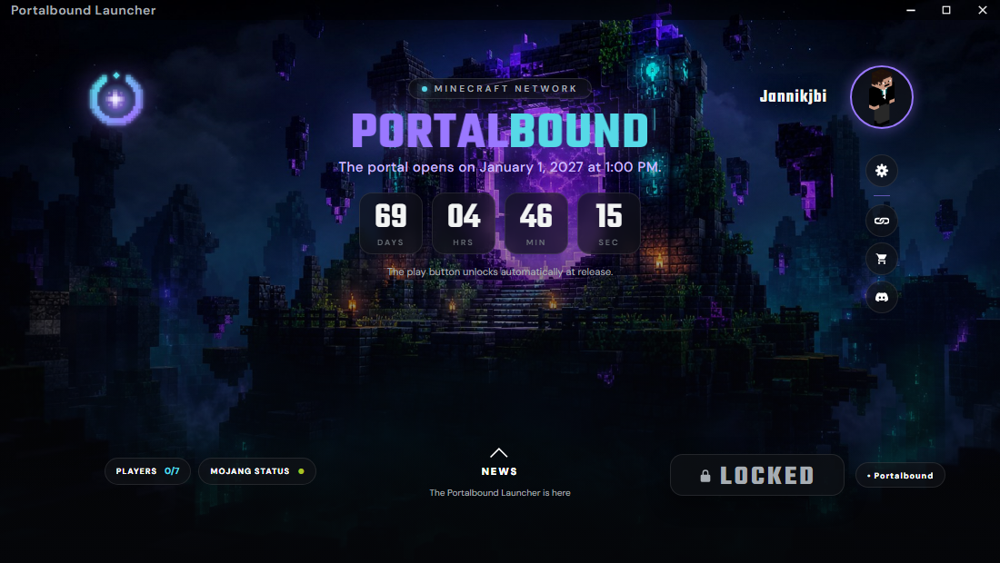
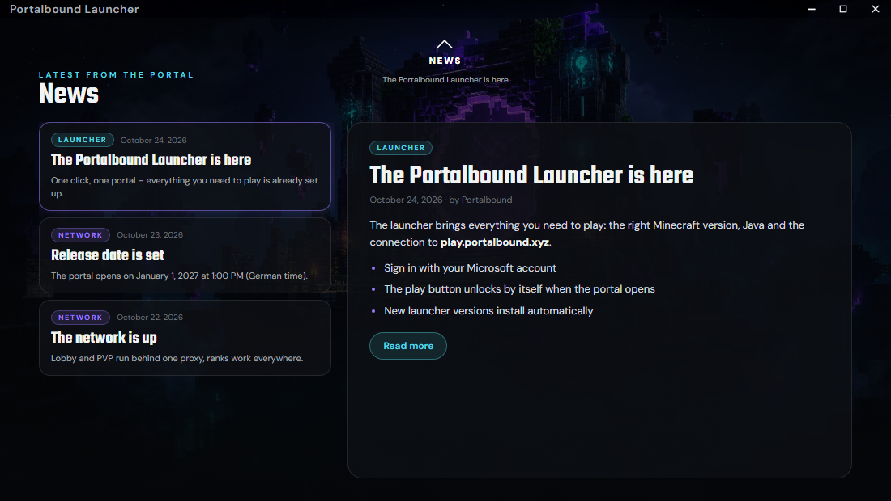
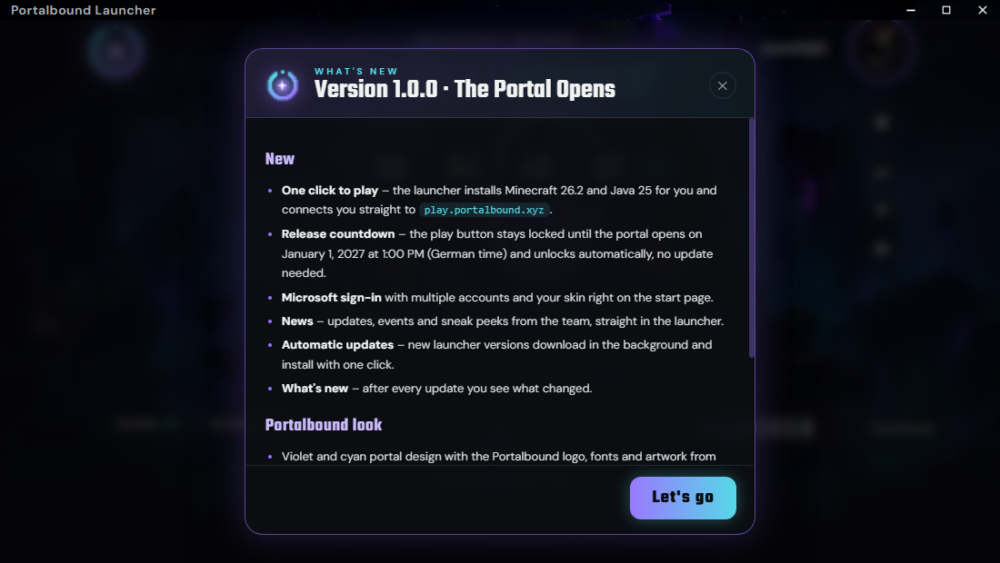

<p align="center"></p>

<h1 align="center">Portalbound Launcher</h1>

<p align="center">Ein Klick. Ein Portal. Der Launcher für <a href="https://portalbound.xyz/">Portalbound</a> – Minecraft, Java und die Verbindung zu <code>play.portalbound.xyz</code> sind schon eingestellt.</p>

Basiert auf [Helios Launcher](https://github.com/dscalzi/HeliosLauncher) von Daniel Scalzi (MIT, siehe `LICENSE.txt`).

<p align="center"></p>

**Download:** [Neuestes Release](https://github.com/Jannikjbi-official/ProtalBound-louncher/releases/latest) – Windows `.exe`, macOS `.dmg` (Apple Silicon / Intel), Linux `.AppImage`.

| News | What's new |
| --- | --- |
|  |  |

## Was der Launcher macht

* Anmeldung mit Microsoft-Konto (Mojang-Konten gibt es nicht mehr, die Option ist ausgeblendet).
* Installiert Minecraft **26.2** (wie die Server, Paper 26.2) und bei Bedarf **Java 25** automatisch.
* Startet Vanilla-Minecraft und verbindet direkt mit `play.portalbound.xyz:25565`.
* Countdown bis zum Release und **automatische Freischaltung** des Spielen-Buttons.
* News als Karten, Changelog mit „What's new“ nach jedem Update, Auto-Update über GitHub.
* Server-Status (Spieler online), Links zu Website, Store und Discord.
* Oberfläche auf Englisch. Eine deutsche Übersetzung liegt in `app/assets/lang/de_DE.toml` – zum Umschalten in `app/assets/js/langloader.js` die Zeile `loadLanguage('de_DE')` aktivieren.

## Release-Sperre

Bis zum Release steht auf dem Button **LOCKED**, oben läuft der Countdown. Wer klickt, bekommt den Hinweis, wann das Portal öffnet.

Die Freischaltung passiert von selbst, ohne Launcher-Update (`app/assets/js/releasegate.js`):

1. **`https://portalbound.xyz/api/launch`** ist die Quelle der Wahrheit. Meldet die Website `"live": true`, ist der Button sofort frei – auch vor dem Termin. Meldet sie `false`, bleibt er gesperrt, auch wenn der Countdown schon abgelaufen ist („The portal is about to open.“). Eine falsch gestellte PC-Uhr kann also nichts früher freischalten.
2. **Release-Datum:** wird aus der Website gelesen (`launchAt`, derselbe Wert wie der Countdown auf portalbound.xyz), sonst aus `app/assets/distribution.json` (`portalbound.releaseAt`), sonst `DEFAULT_RELEASE_AT` = **01.01.2027, 13:00 Uhr** (deutsche Zeit).
3. Ist die Website nicht erreichbar, entscheidet die lokale Uhr gegen das Release-Datum.

Der Launcher fragt die API anfangs alle 10 Minuten, in den letzten 15 Minuten vor Release alle 30 Sekunden und danach alle 10 Sekunden. Beim Freischalten blinkt das Fenster in der Taskleiste und es kommt eine Windows-Benachrichtigung.

**Termin verschieben:** auf der Website `launchAt` ändern – der Launcher übernimmt das beim nächsten Abruf (spätestens nach einer Stunde, sonst beim Neustart).

### Testen (nur im Entwicklungsmodus, `npm start`)

| Variable | Wirkung |
| --- | --- |
| `PORTALBOUND_RELEASE_AT=+30` | Release 30 Sekunden nach dem Start (oder ein ISO-Datum) |
| `PORTALBOUND_LAUNCH_API=http://127.0.0.1:9/` | Website nicht erreichbar simulieren (dann zählt die Uhr) |
| `PORTALBOUND_FORCE_UNLOCK=1` | Sperre komplett aus |

## News und Server-Infos (ohne Release änderbar)

Beides lädt der Launcher direkt aus diesem Repository (Branch `main`). Änderungen auf GitHub sind nach ein paar Minuten in jedem Launcher sichtbar – ohne neues Release. Ist GitHub nicht erreichbar, nimmt er die mitgelieferte Kopie.

- **News:** [`news.json`](news.json). Jeder Eintrag hat `id`, `title`, `date`, `tag` (Launcher, Network, Event, PVP, Update, Store), `author`, `summary`, `content` (Markdown, als Liste von Zeilen) und optional `link`. Neueste nach Datum zuerst. Ein neuer Eintrag lässt den Punkt am NEWS-Knopf aufleuchten.
- **Server-Infos:** [`app/assets/distribution.json`](app/assets/distribution.json) – Server-Adresse, Minecraft-Version, Java, RAM und `portalbound.releaseAt` (Fallback für die Release-Sperre).

## Entwicklung

Voraussetzung: [Node.js](https://nodejs.org/) 22.

```console
npm install
npm start
```

`npm install` wendet über `patch-package` einen kleinen Patch auf `helios-core` an (`patches/`), damit Server ohne Forge/Fabric (Vanilla) gestartet werden können. Deshalb ist `helios-core` fest auf `2.3.0` gepinnt.

DevTools: `Strg + Umschalt + I`.

## Installer bauen

| Plattform | Befehl | Ergebnis in `dist/` |
| --- | --- | --- |
| Windows x64 | `npm run dist:win` | `Portalbound-Launcher-setup-VERSION.exe` |
| macOS | `npm run dist:mac` | `Portalbound-Launcher-setup-VERSION-x64.dmg` / `-arm64.dmg` |
| Linux x64 | `npm run dist:linux` | `Portalbound-Launcher-setup-VERSION.AppImage` |

macOS-Builds gehen nur auf einem Mac.

### Release veröffentlichen (Auto-Update)

Installierte Launcher holen Updates aus den [GitHub Releases](https://github.com/Jannikjbi-official/ProtalBound-louncher/releases), laden sie im Hintergrund und zeigen oben „Restart & update“. Nach dem Neustart erscheint einmal **What's new** mit dem passenden Abschnitt aus dem Changelog.

1. In [`CHANGELOG.md`](CHANGELOG.md) oben einen neuen Abschnitt `## [1.0.1] - JJJJ-MM-TT - Titel` mit `### New` / `### Improved` / `### Fixed` schreiben.
2. Version in `package.json` auf dieselbe Nummer setzen.
3. Committen, dann taggen und pushen:
   ```console
   git tag v1.0.1
   git push origin main --tags
   ```
4. Die GitHub Action [`build.yml`](.github/workflows/build.yml) baut Windows, macOS und Linux und veröffentlicht das Release mit dem Changelog-Abschnitt als Release-Notes.

macOS-Builds sind nicht signiert – auf dem Mac beim ersten Start Rechtsklick → Öffnen. Auto-Update installiert dort nicht selbst, der Launcher bietet den Download an.

## Microsoft-Anmeldung (wichtig vor dem Release)

Der Launcher benutzt aktuell noch die Azure-App-ID von Helios (`app/assets/js/ipcconstants.js`). Für einen eigenen, dauerhaft verlässlichen Login braucht Portalbound eine eigene App:

1. Im [Azure-Portal](https://portal.azure.com/) eine App-Registrierung anlegen, Kontotyp **nur persönliche Microsoft-Konten**.
2. Plattform **Mobile- und Desktopanwendungen** mit der Umleitungs-URI `https://login.microsoftonline.com/common/oauth2/nativeclient`.
3. Bei Mojang die Freigabe für die Minecraft-API beantragen: <https://aka.ms/mce-reviewappid> (dauert ein paar Tage bis Wochen).
4. Nach der Freigabe die neue ID in `AZURE_CLIENT_ID` eintragen.

Details: [`docs/MicrosoftAuth.md`](docs/MicrosoftAuth.md).

## Daten auf dem PC

* Einstellungen und Konten: `%APPDATA%\Portalbound Launcher\`
* Spieldateien, Java, Instanzen: `%APPDATA%\.portalbound\`
